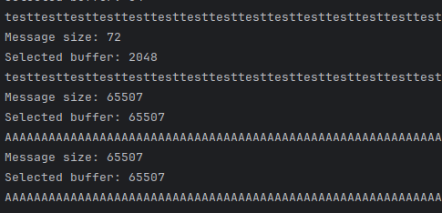
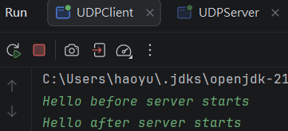
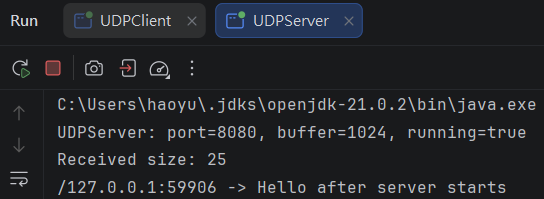
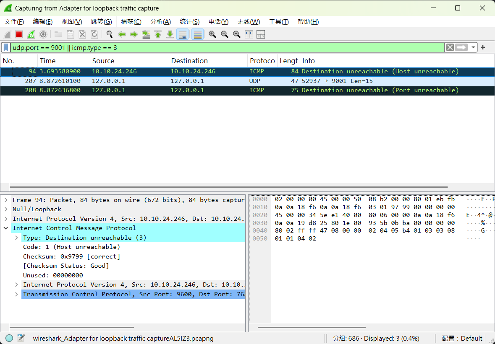
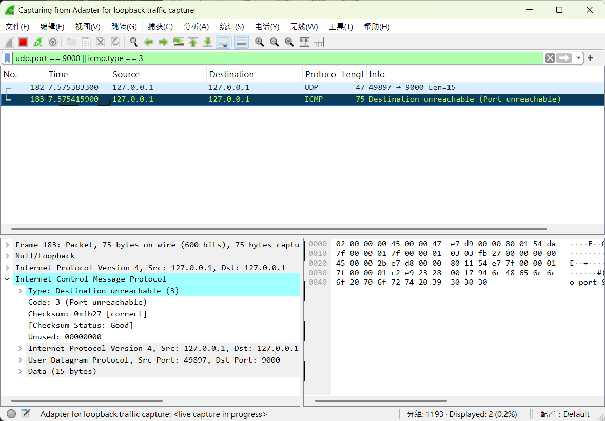
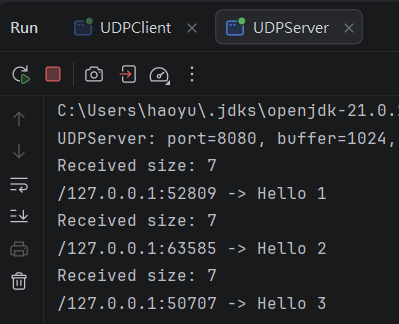

# TP2 — UDP Client-Server with Java

## Part 1 — Creating a UDP Client-Server

We used Java 21 and IntelliJ IDEA to create a UDP client and server. We also used GitHub to share our code.

### Step 1 — UDP Server

First, we created a Java class called `UDPServer.java`.

The server uses `DatagramSocket` to receive UDP messages. We set the default port to 8080 and the buffer size to 1024 bytes.

We also added two constructors, a `launch()` method, a `toString()` method, and a `main()` method.

When we run the server, it waits for messages from clients. When it receives a message, it displays the client's IP address, port number, and message.

**Result:**


Figure 1 — UDPServer running in IntelliJ IDEA

### Step 2 — Test the UDP Server

We used Ncat to test our UDP server.

First, we started `UDPServer.java` on port 8080. Then we opened the Windows terminal and entered:

```cmd
"C:\software\Nmap\ncat.exe" -u localhost 8080
```

We typed `Hello from Ncat` and pressed Enter.

**[Screenshot 1 — Sending a message using Ncat]**

The server received the message and displayed the client's IP address, port number, and message.

```text
/0:0:0:0:0:0:0:1:52092 -> Hello from Ncat
```


**[Screenshot 2 — UDPServer receiving the message from Ncat]**

The test was successful. We confirmed that our UDP server can receive messages from Ncat.

However, Ncat was not installed on our computer, so the command did not work.


### Step 3 — UDP Client

Next, we created another Java class called `UDPClient.java`.

The client reads messages from the keyboard and sends them to the server using UDP.

At first, we used `localhost` and port `8080` because the client and server were running on the same computer.

We opened two programs in IntelliJ IDEA. One was the server and the other was the client.

We sent some messages:

```text
hello
This is my UDP client
how are you
```


The server received all these messages and displayed the client's IP address and port.

**Result:**

```text
/127.0.0.1:56265 -> hello
/127.0.0.1:56265 -> This is my UDP client
/127.0.0.1:56265 -> how are you
```

This shows that our UDP client and server can communicate on the same computer.


**[Screenshot 3 — UDPServer receiving messages from UDPClient]**

### Step 4 — Test Between Two Computers

In this step, we tried to communicate between two computers, one using Windows and the other using Linux.

First, we used `ping` to test the network connection.

On Windows, we used:

```cmd
ipconfig
```

On Linux, we used:

```bash
hostname -I
```

We found these IP addresses on the ENSEA network:

- Windows: `10.10.24.246`
- Linux: `10.10.26.72`

We tried to send UDP messages between the two computers, but the server did not receive them.

We also tried to ping the other computer, but the test failed.


**[Screenshot 1 — Ping failed on the ENSEA network]**

We think the ENSEA network may have network isolation or firewall restrictions. This may stop direct communication between student computers.

So we tried another solution. We connected both computers to the same smartphone hotspot and checked their new IP addresses.

Then we changed the IP address in the UDPClient configuration to `192.168.21.151` and used port `8080`.


**[Screenshot 2 — UDPClient configuration using the hotspot IP address]**

This time, the communication worked. We sent several messages from the client, and the server received them successfully.

The server displayed the client's IP address (`192.168.21.228`), port number, and messages.


**[Screenshot 3 — UDPServer receiving messages from another computer]**

This shows that our UDP client and server can communicate between two different computers.

We also learned that network settings and firewalls can affect UDP communication.


### Part 1 — Conclusion

In this part, we created a basic UDP client and server using Java.

We successfully sent and received UDP messages on the same computer.

We also learned how to use IP addresses and port numbers to communicate between different computers.

One important thing is that UDP does not establish a connection before sending data. Also, sending a message does not guarantee that the server will receive it.


## Part 2 — Creating a UDP Client-Server

### Step 5 

We changed the size of the buffer of the receiver. We made it possible to take three sizes : 64, 2048 and 65507.
The change in the code is the following one, before we just set up a buffer of size : 1024. Now, we get the data and then we calculate the length and we attribute of the 3 sizes. 

### Step 6

We tested what we did and we see that, when the size of the transmitted data is larger than the size of the buffer, our code save only the maximum size and discard the remaining part.


### Step 7

The change in the code is the following one, before 


## Part 3 — Connectionless Communication

In this part, we tested how UDP works without a connection. We used Java and Wireshark to observe the communication between the client and server.

### Step 9(a) — Sending Messages Before Starting the Server

First, we started `UDPClient.java` without running the UDP server.

We sent the following message:

`Hello before server starts`

Then, we started `UDPServer.java` on port 8080.

The server did not receive the first message.

After that, we sent another message:

`Hello after server starts`



This time, the server received the message successfully.



This shows that UDP can send messages without establishing a connection. However, if the server is not running, the messages may be lost. The server cannot receive messages sent before it started.

### Step 9(b) — Sending Messages to Unused Ports

In this step, we sent UDP messages to a port where no server was running.

We used `127.0.0.1` and port `9000` in the UDPClient configuration.

Then, we opened Wireshark and selected the loopback interface.

We used this filter:

```text
udp.port == 9000 || icmp.type == 3
```

We sent the message:

`Hello port 9000`

Wireshark captured two packets:

- UDP: The client sent a message to port 9000.
- ICMP: The system returned a Port Unreachable message.



We checked the ICMP packet and found:

- Type: 3 (Destination Unreachable)
- Code: 3 (Port Unreachable)



This means that the UDP message reached the destination computer, but no application was listening on port 9000.

We learned that UDP does not check if the server is running before sending messages. The operating system can send an ICMP error when the destination port is not available.

### Step 9(c) — Starting and Stopping the UDP Client

In this step, we kept the UDP server running on port 8080.

Then, we started and stopped the UDP client three times.

Each time, we sent a different message:

```text
Hello 1
Hello 2
Hello 3
```

The server received all three messages.

We observed the following results:

| Message | Client IP | Source Port |
|---|---|---|
| Hello 1 | 127.0.0.1 | 52809 |
| Hello 2 | 127.0.0.1 | 63585 |
| Hello 3 | 127.0.0.1 | 50707 |



The IP address was the same because we used the same computer.

However, the source port changed each time we restarted the client.

Also, the server did not show any message when the client stopped.

This shows that UDP does not keep a connection between the client and server.

### Step 10 — Questions

#### (a) Compare UDP with TCP in Step 9(a) and Step 9(c).

With UDP, the client can send messages even if the server is not running. However, the messages may be lost.

With TCP, the client must establish a connection first. If the server is not running, the connection usually fails.

When a UDP client stops, the server does not know directly.

With TCP, the server can detect when the connection is closed.

#### (b) Why is UDP used for DNS, video streaming, and online games?

UDP is used because it has low overhead and does not need to establish a connection.

For DNS, UDP is useful for small and fast queries.

For real-time video streaming, low delay is important. Sometimes it is better to continue playing than to wait for lost packets.

For online games, fast communication is important. Some lost packets can be ignored because new data is sent frequently.

### Part 3 — Conclusion

In this part, we learned that UDP is a connectionless protocol.

The client can send messages without establishing a connection with the server.

We also observed ICMP Port Unreachable messages using Wireshark.

Finally, we found that the source port may change when a client restarts, and the UDP server does not directly detect when a client stops.

