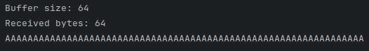
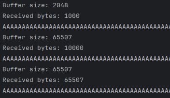

# TP2 — UDP Client-Server with Java

## Part 1 — Creating a UDP Client-Server

We used Java 21 and IntelliJ IDEA to create a UDP client and server. We also used GitHub to share our code.

### Step 1 — UDP Server

First, we created a Java class called `UDPServer.java`.

The server uses `DatagramSocket` to receive UDP messages. We set the default port to 8080 and the buffer size to 1024 bytes.

We also added two constructors, a `launch()` method, a `toString()` method, and a `main()` method.

When we run the server, it waits for messages from clients. When it receives a message, it displays the client's IP address, port number, and message.

**Result:**


Figure 1 — UDPServer running in IntelliJ IDEA

### Step 2 — Test the UDP Server

We used Ncat to test our UDP server.

First, we started `UDPServer.java` on port 8080. Then we opened the Windows terminal and entered:

```cmd
"C:\software\Nmap\ncat.exe" -u localhost 8080
```

We typed `Hello from Ncat` and pressed Enter.

**[Screenshot 1 — Sending a message using Ncat]**

The server received the message and displayed the client's IP address, port number, and message.

```text
/0:0:0:0:0:0:0:1:52092 -> Hello from Ncat
```


**[Screenshot 2 — UDPServer receiving the message from Ncat]**

The test was successful. We confirmed that our UDP server can receive messages from Ncat.

However, Ncat was not installed on our computer, so the command did not work.


### Step 3 — UDP Client

Next, we created another Java class called `UDPClient.java`.

The client reads messages from the keyboard and sends them to the server using UDP.

At first, we used `localhost` and port `8080` because the client and server were running on the same computer.

We opened two programs in IntelliJ IDEA. One was the server and the other was the client.

We sent some messages:

```text
hello
This is my UDP client
how are you
```


The server received all these messages and displayed the client's IP address and port.

**Result:**

```text
/127.0.0.1:56265 -> hello
/127.0.0.1:56265 -> This is my UDP client
/127.0.0.1:56265 -> how are you
```

This shows that our UDP client and server can communicate on the same computer.


**[Screenshot 3 — UDPServer receiving messages from UDPClient]**

### Step 4 — Test Between Two Computers

In this step, we tried to communicate between two computers, one using Windows and the other using Linux.

First, we used `ping` to test the network connection.

On Windows, we used:

```cmd
ipconfig
```

On Linux, we used:

```bash
hostname -I
```

We found these IP addresses on the ENSEA network:

- Windows: `10.10.24.246`
- Linux: `10.10.26.72`

We tried to send UDP messages between the two computers, but the server did not receive them.

We also tried to ping the other computer, but the test failed.


**[Screenshot 1 — Ping failed on the ENSEA network]**

We think the ENSEA network may have network isolation or firewall restrictions. This may stop direct communication between student computers.

So we tried another solution. We connected both computers to the same smartphone hotspot and checked their new IP addresses.

Then we changed the IP address in the UDPClient configuration to `192.168.21.151` and used port `8080`.


**[Screenshot 2 — UDPClient configuration using the hotspot IP address]**

This time, the communication worked. We sent several messages from the client, and the server received them successfully.

The server displayed the client's IP address (`192.168.21.228`), port number, and messages.


**[Screenshot 3 — UDPServer receiving messages from another computer]**

This shows that our UDP client and server can communicate between two different computers.

We also learned that network settings and firewalls can affect UDP communication.


### Part 1 — Conclusion

In this part, we created a basic UDP client and server using Java.

We successfully sent and received UDP messages on the same computer.

We also learned how to use IP addresses and port numbers to communicate between different computers.

One important thing is that UDP does not establish a connection before sending data. Also, sending a message does not guarantee that the server will receive it.


## Part 2 — Creating a UDP Client-Server

### Step 5 

We changed the size of the buffer of the receiver. We made it possible to take three sizes : 64, 2048 and 65507.
The change in the code is the following one, after receiving in the largest buffer that is possible, we measure the effective size of the packet and then we attribute a buffer with a relevant size.



As we can see, when we sent a packet of 64 bytes, we are able to retreive all the 64 bytes. 

We had some issue to understand the question. We thought that we have to buid a code that would be able to check the size of the received packet before receiving it. I made some research and it is not possible in a simple way. What I found is that we call to use a system call : a special function in linux that will reach the information about the size of a datagram received at the kernel level. 

### Step 6

In this part, 


### Step 7

The change in the code is the following one, before 


### Step 8 

a. Why is the size of the receive buffer chosen by the receiver and not by the sender?

The main reason is because it is the responsabily to the receiver to allocte the memory space in order to save the content sent by the sender. 

b. Why is it a bad idea to send datagrams larger than about 1 400 bytes on a real network, even if UDP accepts up to 65 507 bytes?

It is true that UDP allow up to 65 507 bytes, however, the physical path of a packet can cross parts where there is some error and then the packet is corrupted. Sending one byte by one byte is really not efficient and sending a lot of bytes is really painful when there is an error and must be send again. 1400 bytes is compromise between efficiency and accuracy. 
Futhermore, in some networks, it is possible to find packets that are bigger than 1400 bytes because the path of a packet is more sure. 
